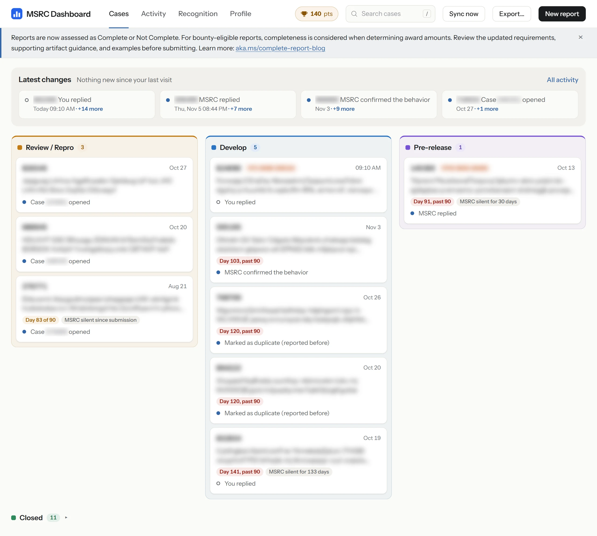
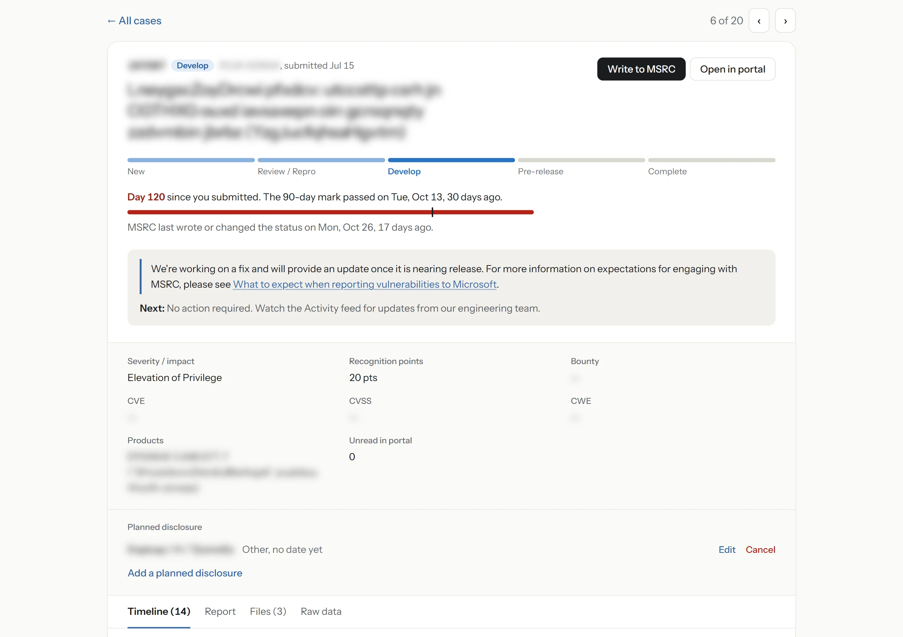
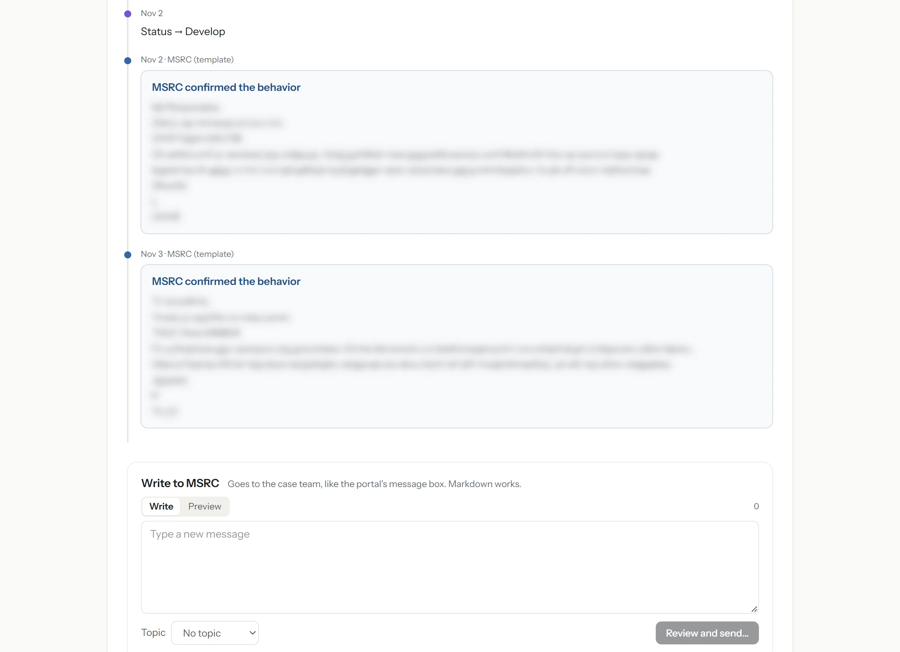
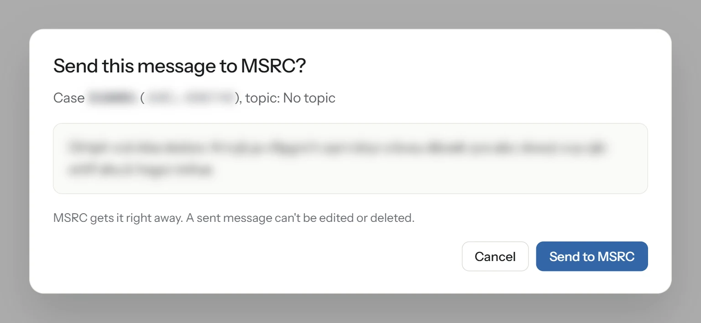
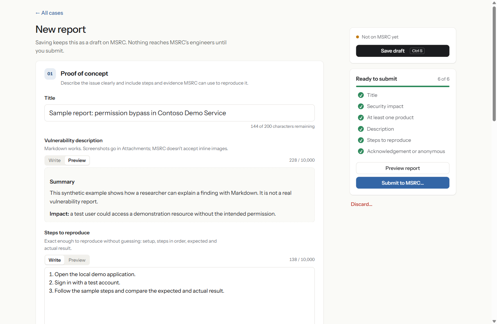
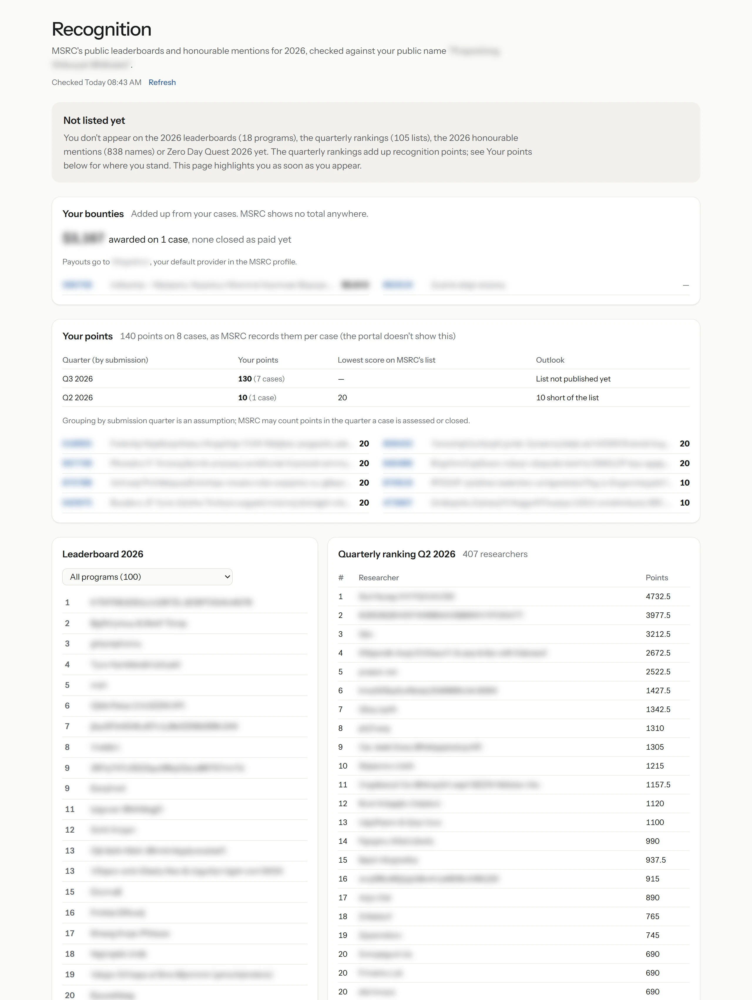

# MSRC Dashboard

## Executive summary

MSRC Dashboard is a browser extension that makes the everyday vulnerability-reporting workflow
easier to manage. Sign in to the [MSRC Researcher Portal](https://msrc.microsoft.com/report/vulnerability)
once, then use the dashboard as your main workspace for drafting and submitting reports, attaching
evidence, replying to cases, and managing planned disclosures. Before submission, you can preview
your report and run MSRC's own AI assessment and report-quality checks.

The dashboard brings your submissions into one local view and makes changes easier to spot: new
messages, status and bounty updates, cases that need a response, disclosure timing, public CVEs,
recognition points, and award totals. It renews your session in the background and sends desktop
notifications, so you can keep up with your cases without repeatedly signing in or checking each
one by hand.

MSRC remains the source of truth. You can open any case in the portal when needed, while the
dashboard handles most day-to-day researcher work in a more focused interface. Changes to the
portal's API may require updates to the extension.

> [!IMPORTANT]
> **Unofficial, independent project.** MSRC Dashboard is not a Microsoft product and is not
> affiliated with, sponsored by, or endorsed by Microsoft or the Microsoft Security Response
> Center (MSRC).

Licensed under the [MIT License](LICENSE).



<sub>Case screenshots show real cases with identifying details scrambled and blurred. The report screenshot uses sample text.</sub>

## What it does

- **Board.** Your cases in columns by MSRC stage (New, Review / Repro, Develop, Pre-release,
  Complete), with what changed since your last visit on top. A case MSRC has put on hold until you
  reply is marked **Action required**. Cases near or past the 90-day disclosure mark, and cases MSRC
  has gone quiet on, are tagged. Search with `/`, step through cases with `j` and `k`.
- **Case page.** The portal's case data, including cross-tenant impact and Canary reproduction answers, plus one timeline of messages, status changes (with
  the exact time from MSRC's notification feed) and file uploads. On top: the case's day against the
  90-day mark and when MSRC last wrote, MSRC's banner for the case, and the portal's explanation of
  what the status means and what, if anything, you should do.
  Messages and report text render as Markdown.
- **Notifications.** A desktop notification when MSRC replies, a status or bounty changes, or a CVE
  appears. It checks every 2 minutes (two requests when nothing changed) and re-reads everything
  every 6 hours.
- **Public CVEs.** Reads Microsoft's public Security Update Guide for CVEs that credit you, which
  often appear before MSRC updates the case. It suggests the matching case and you confirm it.
- **Recognition and bounties.** Recognition points per case (the portal stores them but doesn't
  show them), leaderboards, and the bounty awards added up across your cases.
- **Reports.** MSRC's report form on one page: drafts saved on MSRC, local autosave, attachments
  encrypted the same way the portal does it, a checklist of what MSRC requires, active-exploit
  details, MSRC's AI case assessment and quality checks before submission, and a typed
  confirmation before submitting. Running the checks saves a draft on MSRC first.
- **Messages.** A message box on each case, with a preview before anything is sent.
- **Planned disclosures.** Add, change or cancel a planned talk or blog post on a submitted case,
  as on the portal's Disclosure tab. Each change is confirmed in a dialog first.
- **MSRC announcements.** The portal's site-wide alert and banners appear at the top, dismissible.
- **Portal internals.** A page (linked from Profile) showing what the portal publishes about
  itself: its AI pre-screening setup, the environments compiled into its script, and its feature
  flags with MSRC's own descriptions.
- **Export.** One JSON file with everything about your cases, including a field guide for an LLM.
- **Staying signed in.** The portal's session is kept alive and renewed in a background tab, so
  there's no daily sign-in.

## A look around

### A case



Everything about a case on one page: where it is in MSRC's pipeline, its day against the 90-day
disclosure mark, MSRC's explanation of the status, every field the portal has, and your planned
disclosures. When MSRC puts a case on hold until you reply, a red **Action required** box
appears here, and **Reply to MSRC** takes you straight to the message box.

### Messages



Messages, status changes and uploads in one timeline, with what's new since your last visit
marked. You write back from the same page, in Markdown.



Nothing goes to MSRC until you've seen the message in a preview and confirmed it.

### Reports



MSRC's report sections in the portal's order—proof of concept, security impact, acknowledgement,
public disclosure, and additional information—with a checklist of what MSRC requires before you submit. Use
**Preview report** for a local Markdown preview of the complete report text, or the Write/Preview
tabs beside individual text fields. Drafts are saved on MSRC, and your text is also kept locally as
you type.

### Recognition and bounties



Your bounties added up across all cases, recognition points per case and quarter, and where you
stand on MSRC's leaderboards.

## Install

You need a Chromium browser, version 120 or later (Brave, Chrome, Edge).

If you have a `dist/` folder (a prebuilt copy), skip to step 3. Otherwise build it, which needs
Node.js 22.12 or later:

1. `npm ci`
2. `npm run build` (writes `dist/`)
3. Open `brave://extensions` (or `chrome://extensions`), turn on **Developer mode**, click
   **Load unpacked** and pick the `dist/` folder.
4. Sign in on the [portal](https://msrc.microsoft.com/report/vulnerability) once, in a normal tab.
5. Click the extension's toolbar icon to open the dashboard. The first load reads all your cases
   and messages and takes about a minute.

Keep Developer mode on. With it off, Brave and Chrome may disable unpacked extensions on restart.

To update, replace the folder, then click the reload icon on the extension's card. Your data stays.
[CHANGELOG.md](CHANGELOG.md) lists what changed in each version.

## Security and privacy

Read this before installing.

- **Your MSRC session is stored unencrypted.** To stay signed in, the extension keeps a copy of
  the portal's session, including its refresh token, in the extension's storage inside your browser
  profile. Anyone who can read that profile can act as you on the portal until the token expires.
  Use it only in a profile you trust.
- **Signed-in portal tabs are seeded.** A new tab on `msrc.microsoft.com/report` gets that session
  copied in, so it doesn't bounce to the sign-in page.
- **Everything else stays local.** Cases, messages and settings live in the browser's own storage.
  There are no servers and no telemetry. The only host it contacts is Microsoft's: the portal, its
  API and its sign-in service.
- **The public CVE check sends nothing about you.** It reads the Security Update Guide without
  signing in, and matches your credit name on your machine.
- **Nothing is sent to MSRC without a click.** Saving a draft, attaching a file, submitting,
  sending a message and changing a planned disclosure are each an explicit action. Submitting,
  attaching, sending and cancelling a disclosure ask for confirmation, because none can be undone.
- **Exports contain your case data** (titles, report text, messages) but never login tokens.

Removing the extension deletes everything it stored.

## Development

```
npm ci
npm run build        # dist/, load it unpacked
npm run watch        # rebuild on change (restart for changes in static/)
npm test             # Vitest; no network
npm run typecheck
```

- `src/background/`: the service worker (session, sync, notifications).
- `src/content/`: the content script on portal pages (session hand-off, background sign-in).
- `src/dashboard/`: the Preact UI.
- `src/core/`: pure logic, most of it unit-tested.
- `tests/`: synthetic data only.

The portal's GraphQL gateway accepts only its own query texts, so the queries in
`src/background/queries.ts` are verbatim copies and must not be reformatted.

## Thanks

Thanks to [TinySec](https://x.com/TinySecEx) for the inspiration. His
[msrc-ext](https://github.com/tinysec/msrc-ext), an extension for the MSRC Researcher Portal,
showed how much a browser extension can add to it.
